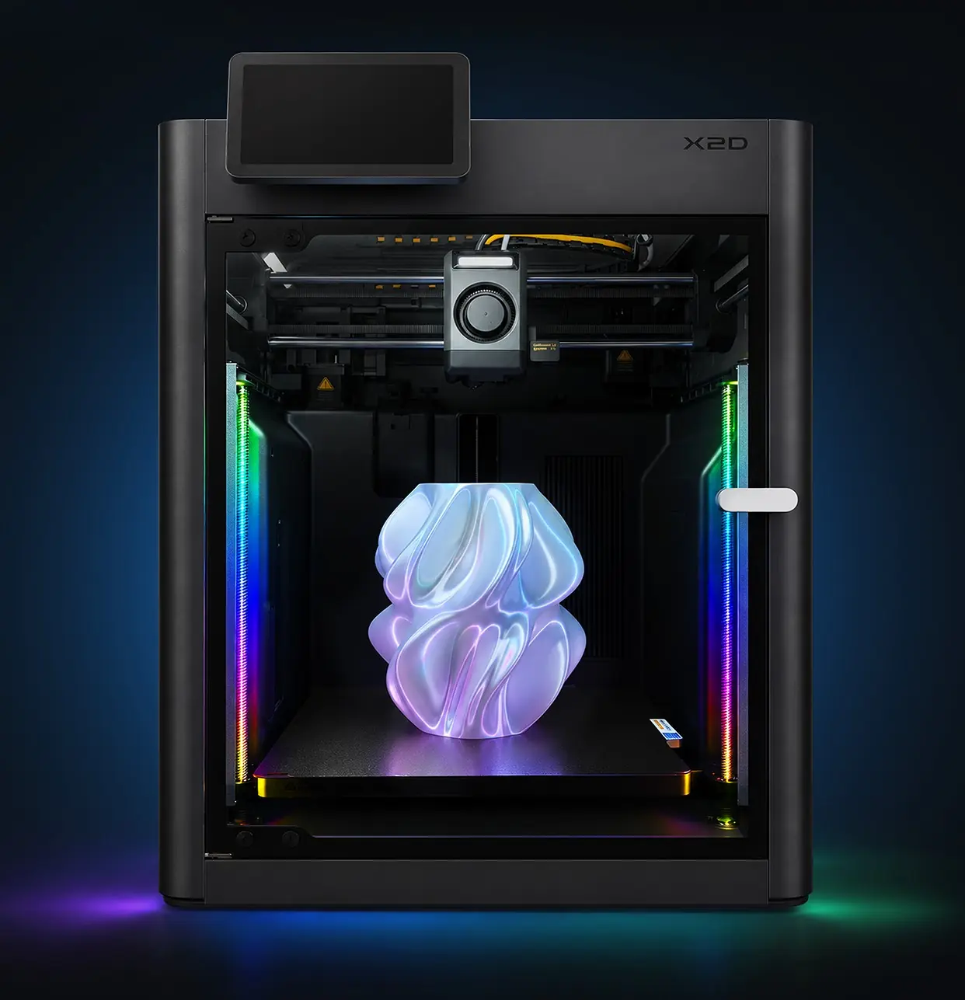

# Panda Lux RGB PX2

  

## **Introduction**

Panda Lux RGB PX2 is a dual RGB light bar kit designed for Bambu Lab P2S and X2D printers. It uses the same controller platform, firmware, and operating workflow as the Panda Lux RGB PX, while introducing a dedicated PX2 installation structure, dual light bars, and the Panda Hub PX2 power module.

## **Feature Highlights**

- **Dual RGB Light Bars**  
  Provides RGB lighting on both the left and right sides of the printer for more balanced illumination and visual effects.

- **Printer Lighting Sync**  
  Supports synchronized on/off control with the printer's original lighting state.

- **Multiple Lighting Effects**  
  Includes Static, Breathing, Strobing, Wave, Marquee, Color Cycle, Rainbow, Warning: Hot, and H2D Style Status Indicator modes.

- **Web Control**  
  Adjust lighting effects, color, brightness, and speed through the controller Web UI.

- **Easy Maintenance**  
  Supports OTA firmware updates and factory reset directly from the Settings page.

## **Supported Configuration**

| **Item** | **Specification** |
| --- | --- |
| Supported Printers | Bambu Lab P2S and X2D |
| Light Bars | Two RGB light bars |
| Controller | Same controller platform as Panda Lux RGB PX |
| Firmware / Web UI | Same firmware and operating workflow as Panda Lux RGB PX |
| Power Module | Panda Hub PX2 |
| Installation | PX2-specific printed mounts, magnetic light bar mounting, and dedicated cable routing structure |

## **Links**

| **Wiki** | **www.com** |

| **Buy it here** | **www.com** |

# Copyright 

These files and the designs contained therein are copyright (c) 2026 BIQU.

These files and the designs contained therein are additionally licensed under **CC-BY-NC-ND-4.0**.
